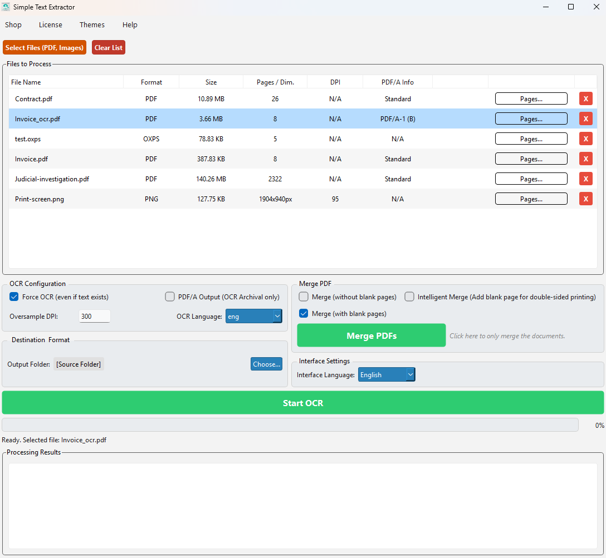

# Simple Text Extractor - English Version 1.7
**Available on Microsoft Store (Windows) • Available on Snap Store (Linux)**

# Copyright © Gaëtan Sencie 2025-2026
# All rights reserved.

## Description

**Simple Text Extractor** is a fast, high-performance, and **100% offline** desktop document workstation. More than a simple OCR utility, it is engineered from the ground up to be a **privacy-first solution**, guaranteeing absolute data confidentiality. Securely extract text, merge documents, and read sensitive files while ensuring your data never leaves your computer.

The application combines a powerful multilingual **OCR engine**, an intelligent **PDF Merger** with granular page pre-filtering, and an innovative built-in **Secure Viewer**. Validated and published on the **Microsoft Store and the Snap Store**, it provides a robust, seamless, and completely isolated circuit to manage, process, and inspect your documents locally with zero risk of data leakage.


## Preview




### Compatibility

Desktop application designed for:

- **Windows**: 10 and 11 (64-bit).
- **Linux**: Available via Snap package on **Ubuntu** and compatible distributions.


### Features

- **Total Privacy & Zero-Persistence:** All operations are performed strictly locally without an internet connection. The application handles data from end to end in closed-loop isolation.

- **Embedded Secure Viewer:** Open and consult your **PDF, XPS, OXPS** files **and images (PNG, JPG, JPEG, TIFF, BMP)** instantly within a natively sandboxed window, without relying on web browsers, system image viewers, or unsecure third-party readers.
  - **In-Memory Processing:** Documents and images are loaded directly into RAM using a native rendering engine. All intermediate processing steps and view caches are handled strictly in-memory, leaving zero residual technical traces on the disk after execution.
  - **In-App Validation:** Quickly run a full-text search or copy text directly inside the viewer to validate your OCR results instantly.
  - **Secure Printing:** A clean, built-in printing module allows generating physical copies safely without passing through vulnerable system print spools.

- **Enterprise-Grade Security & Core Isolation (CWE Compliance):**
  - **Log Anonymization (CWE-209):** All system logs utilize an advanced anonymization algorithm that systematically replaces usernames and personal folder paths with `<path_anonymized>`, ensuring your local directory tree remains strictly confidential.
  - **Log Injection Mitigation (CWE-117):** Third-party process streams (Tesseract, Ghostscript) are thoroughly filtered and ASCII control characters are escaped to prevent malicious metadata from corrupting system terminals or logs.
  - **Atomic File Handling (CWE-377):** Temporary file processing relies on secure "atomic bunkers" (`TemporaryDirectory` with strict `0700` permissions). Upon success, error, or cancellation, files are instantly purged by the OS without leaving residual traces.
  - **Cross-Site Scripting Mitigation (CWE-79):** File names injected into graphical user interface dialog boxes are systematically sanitized and escaped (`html.escape`) to prevent any potential UI injection or XSS vectors.

- **DoS Prevention & Zero-Freeze Stability:**
  - **Memory Allocation Limits:** Pillow image processing enforces strict pixel limits (178 million pixels maximum) to neutralize decompression bombs.
  - **DPI Normalization (OOM Prevention):** A strict standard of 300 DPI is enforced for internal image rendering, preventing the generation of monstrous volumetric files and Out-Of-Memory crashes.
  - **Zero-Freeze Multiprocessing Architecture:** Heavy tasks run asynchronously in isolated worker pools, ensuring that cancelling or running large batches (2000+ pages) happens instantaneously without freezing or locking the graphical interface.

- **Smart PDF Merger & Custom Page Pre-Filter:** Advanced tool to combine multiple files (PDF, XPS, OXPS, Images) into a single document with a **custom per-file page pre-filter** and 3 specialized global modes:
  - **Granular Page Selection (Pre-Filter):** Use the dedicated **"Pages"** button on any row in the queue to check or uncheck specific pages before processing. The button dynamically updates to **"Pages (filtered)"** when active and combines seamlessly with any of the 3 global merge modes below (as well as batch OCR):
  - **All Pages:** Simple and fast merge of all selected pages across your documents.
  - **No Blanks:** Automatically detects and removes blank pages (based on pixel ink coverage) from your selection.
  - **Intelligent (Duplex):** Ensures perfect parity for double-sided printing by adding a blank page only where necessary.

- **Multilingual Interface (Persistent):** The application speaks your language! The interface and status messages dynamically adapt to 7 languages: **English, French, German, Spanish, Italian, Brazilian Portuguese, and Japanese**, and automatically remember your preference across sessions.

- **Multilingual OCR Support (17+ Languages):** Native optical recognition for French, English, German, Dutch, Italian, Spanish, Portuguese, Chinese (Simplified), Arabic, Japanese, Russian, Turkish, Vietnamese, Norwegian, Swedish, Danish, and Greek, with automatic saving of your preferred OCR dictionary.

- **Modern Multi-Column Interface & Batch Processing:** Fluid and ergonomic graphical interface with high-resolution screen support. Drag and drop dozens of files into the structured queue, reorder them via internal Drag & Drop, and process them automatically in sequence without UI freezing.

- **Customizable Themes:** Easily switch between five tailored visual modes: Cyber-Electric, Arcade, Neon, Dark, or System Default, via the dedicated "Themes" tab in the application menu for optimal reading comfort.

- **Structured Metadata Analysis:** Immediate visualization of technical details aligned in dedicated columns (**Name, Format, Size, Pages, DPI, PDF/A Info**) before processing.

- **Archiving Format (PDF/A):** Option to generate files compliant with the long-term archiving standard (PDF/A-1b).

- **Flexible Queue Management:** Filter pages per document, reorder files by dragging, remove items one by one, or clear the entire queue in a single click.


### Supported Formats

The application natively handles both vector and raster documents with optimized processing for each type:

- **Documents**: `PDF` (including heavy scanned volumes and hybrid text/image files), `XPS`, and `OXPS`.
- **Images**: `PNG`, `JPG`, `JPEG`, `TIFF`, and `BMP`.


### Usage

To process or view documents with **"Simple Text Extractor"**:

**1. Add files:**
- Click the "Choose Input PDF or Image" button or simply drag your files (PDF, XPS, OXPS, or Images) into the application window.

**2. Select the Action, Pages, or Language:**
- **Optional Page Pre-Filter:** Click the **"Pages"** button on any queued file to select or exclude specific pages prior to OCR or PDF merging.
- **For text extraction:** In the 'OCR Language' dropdown menu, choose the language corresponding to your document's text. Selecting the right language is crucial for optimal accuracy.
- **For merging:** Arrange the order of your documents in the queue by dragging them and select your preferred merging mode (*All Pages*, *No Blanks*, or *Intelligent Duplex*).

**3. Preview and Inspect (Secure Viewer):**
- Simply **double-click** any file in the queue (or right-click and select **'Secure View'**), or click the **"eye" icon (👁️)** on the final results dashboard.
- Use the built-in search bar to highlight keywords, select text to copy, adjust zoom levels (*Fit to Width* by default), or safely print the document.

**4. Configure output (Optional):**
- By default, files are saved in the same folder as the source. You can define a specific folder via the "Choose..." button in the Destination section.
- Check the "Archiving Format (PDF/A)" box if you want a document optimized for long-term preservation.

**5. Start processing & Results:**
- Click "Start OCR" or "Merge PDF". Follow the progress via the loading bar. Once finished, click the displayed links to open the destination folder.


### Advantages

- **Industrial Stability:** Built on a robust Multiprocessing architecture, ensuring a zero-freeze user interface even with heavy files (up to 2000+ pages).
- **Absolute Privacy:** Ideal for legal, medical, or corporate data processing since no cache, no internet packets, and no raw stacktraces are leaked outside the local application environment.
- **Simplicity:** Tooltips guide the user through every single option with no administrative configuration required, while your language and theme preferences are automatically preserved.

### Snap Store & Linux Specifics (Strict Confinement)

**Turnkey Experience**: The Linux (Snap) version is an **"all-in-one"** package under strict confinement. It comes pre-packaged with the **Tesseract OCR** engine and language dictionaries (**French, English, German, Dutch, Italian, Spanish, Portuguese, Chinese (Simplified), Japanese, Arabic, Russian, Turkish, Vietnamese, Swedish, Norwegian, Danish, and Greek**). No complex installation is required.

💡 **Tip:** Using Wayland? If Drag & Drop doesn't work, please use the "Add Files" button or switch to an X11 session.

⚠️ **Note regarding external drives (USB/SD)**: Since the application runs in a secured environment, it cannot access your external drives by default. If your files are stored on a USB flash drive or a second hard drive, you must grant access by running this command once in your terminal:

```bash
sudo snap connect simple-text-extractor:removable-media
```


## Download

- [Download from Microsoft Store](https://apps.microsoft.com/detail/9NVRKF4X80JZ?hl=en-us&gl=US)
- [](https://snapcraft.io/simple-text-extractor)
- Or via the terminal:

```bash
sudo snap install simple-text-extractor
```

- [GitHub Releases](https://github.com/STENS66/Simple-Text-Extractor/releases)

## Contact

- Email: app.sencie@gmail.com
- LinkedIn: [Gaëtan Sencie](https://www.linkedin.com/in/ga%C3%ABtan-sencie-applications-python)
- GitHub: [STENS66](https://github.com/STENS66)

Thank you for using **"Simple Text Extractor"**!

---

## References & Keywords

Developed by **Gaëtan Sencie**, Python developer.

**Simple Text Extractor** is officially available on the **Microsoft Store**, **GitHub**, and the **Snap Store**, ensuring reliable and validated distribution.

**Keywords**: OCR, Secure PDF Viewer, PDF Reader, PDF Merger, Custom page selection, PDF page filter, Local OCR, Privacy-first app, Offline text extractor, Data security, PDF to text, Tesseract OCR, In-Memory viewer, CWE-377, CWE-209, CWE-117, CWE-79, Log Anonymization, DoS prevention, Zero-Freeze UI, Duplex PDF merge, Remove blank pages, PDF/A-1b, Linux Snap, Ubuntu, Windows 11 desktop app, Python, Secure Image Viewer, RAM Image Viewer, XPS Viewer, OXPS OCR, Multilingual UI.

---

# Simple Text Extractor - Version française 1.7
**Disponible sur le Microsoft Store (Windows) • Disponible sur le Snap Store (Linux)**

# Copyright © Gaëtan Sencie 2025-2026
# Tous droits réservés.


## Description

**Simple Text Extractor** est une station de travail documentaire de bureau rapide, performante et **100% hors ligne**. Bien plus qu'un simple outil d'OCR, cette application a été entièrement pensée pour **respecter la vie privée** et garantir une confidentialité absolue de vos données. Extrayez du texte, fusionnez des PDF et visualisez des documents sensibles en toute sécurité, sans que vos fichiers ne quittent jamais votre ordinateur.

L'application intègre nativement un puissant moteur de **reconnaissance optique (OCR)**, un système de **fusion de PDF intelligent** avec pré-filtrage granulaire des pages, et un module innovant de visualisation appelé **Secure Viewer**. Validée et publiée sur le **Microsoft Store et le Snap Store**, elle offre un circuit fermé totalement isolé pour gérer, traiter et contrôler vos documents en local, sans aucun risque de fuite de données.


## Prévisualisation


### Compatibilité

Application de bureau conçue pour :

- **Windows** : 10 et 11 (64 bits).
- **Linux** : Disponible via paquet Snap sur **Ubuntu** et distributions compatibles.


### Fonctionnalités

- **Confidentialité Totale & Zéro Persistance :** Toutes les opérations sont effectuées exclusivement en local, sans aucune connexion internet ni dépendance à un cloud tiers.

- **Visionneur Sécurisé Intégré (Secure Viewer) :** Ouvrez et consultez vos fichiers **PDF, XPS, OXPS** ainsi que vos **images (PNG, JPG, JPEG, TIFF, BMP)** directement dans une fenêtre nativement isolée (sandboxée), sans passer par un navigateur web, une visionneuse système ou un logiciel tiers vulnérable.
  - **Lecture 100% en mémoire vive (RAM) :** Les documents et les images sont chargés directement dans la RAM à l'aide d'un moteur de rendu natif. Toutes les étapes de traitement intermédiaire et les caches de visualisation sont gérés exclusivement en mémoire vive, ne laissant aucune trace technique résiduelle sur le disque après exécution.
  - **Validation OCR immédiate :** Un moteur de recherche plein texte et une fonction de copie sont intégrés pour vérifier instantanément la qualité de l'OCR.
  - **Impression sécurisée :** Module d'impression directe via un canal sécurisé, évitant les spools système non protégés.

- **Sécurité de Niveau Entreprise & Conformité CWE :**
  - **Anonymisation des logs (CWE-209) :** Les journaux système utilisent un algorithme de masquage strict remplaçant les noms d'utilisateurs et chemins locaux par la balise `<path_anonymized>`.
  - **Prévention des injections de logs (CWE-117) :** Les flux de processus tiers (Tesseract, Ghostscript) sont filtrés et les caractères de contrôle ASCII sont échappés pour empêcher l'injection de métadonnées.
  - **Gestion atomique des fichiers (CWE-377) :** Utilisation de "bunkers atomiques" (`TemporaryDirectory` en `0700`) annihilés immédiatement après exécution par l'OS.
  - **Protection XSS / UI (CWE-79) :** Les noms de fichiers injectés dans les boîtes de dialogue graphiques sont systématiquement protégés par `html.escape`.

- **Prévention DoS & Stabilité "Zero-Freeze" :**
  - **Limitation mémoire (Pillow) :** Plafond strict fixé à 178 millions de pixels pour neutraliser les bombes de décompression.
  - **Normalisation DPI (Anti-OOM) :** Enforcement rigoureux à 300 DPI pour les générations internes, évitant les fichiers volumétriques monstrueux.
  - **Architecture Multiprocessus :** Annulation instantanée des tâches lourdes sans aucun gel de l'interface graphique ("Zero-Freeze UI").

- **Fusion PDF Intelligente & Pré-filtre de Pages sur Mesure :** Outil avancé pour combiner plusieurs fichiers (PDF, XPS, OXPS, Images) en un seul document grâce à un **pré-filtre de sélection manuelle par fichier** combinable avec 3 modes globaux spécialisés :
  - **Sélection Manuelle des Pages (Pré-filtre) :** Un bouton dédié **"Pages"** sur chaque ligne de la file d'attente permet de cocher ou décocher individuellement les pages à conserver. Le bouton passe dynamiquement à **"Pages (filtrées)"** lorsqu'une sélection est active et se combine directement aux 3 moteurs globaux ci-dessous (ainsi qu'au traitement OCR) :
  - **Toutes les pages :** Fusion simple et rapide de l'intégralité des pages retenues.
  - **Sans pages blanches :** Détecte et supprime automatiquement les pages vides (basé sur la couverture d'encre) parmi votre sélection.
  - **Intelligent (Recto-Verso) :** Assure une parité parfaite pour l'impression recto-verso en ajoutant une page blanche uniquement là où c'est nécessaire.

- **Interface Multilingue (Persistante) :** L'application parle votre langue ! L'interface et les messages d'état s'adaptent dynamiquement à 7 langues : **Français, Anglais, Allemand, Espagnol, Italien, Portugais Brésilien et Japonais**, avec mémorisation automatique de votre préférence à chaque fermeture.

- **Support OCR Multilingue (17+ Langues) :** Reconnaissance optique native pour le Français, Anglais, Allemand, Néerlandais, Italien, Espagnol, Portugais, Chinois (Simplifié), Arabe, Japonais, Russe, Turc, Vietnamien, Norvégien, Suédois, Danois et Grec, avec sauvegarde automatique du dernier dictionnaire utilisé.

- **Interface Moderne en Colonnes & Traitement par Lots :** Interface graphique fluide et ergonomique avec support de la haute résolution. Ajoutez des dizaines de fichiers dans la file d'attente par simple Glisser-Déposer (Drag & Drop), réorganisez leur ordre à la souris et traitez-les en arrière-plan sans gel de l'application.

- **Thèmes Personnalisables :** Basculez facilement entre cinq modes visuels sur mesure : Cyber-électrique, Arcade, Néon, Sombre ou Système par défaut, via l'onglet dédié "Thèmes" présent dans le menu de l'application pour un confort de lecture optimal.

- **Analyse Structurée des Métadonnées :** Visualisation immédiate des détails techniques alignés sous des colonnes dédiées (**Nom, Format, Taille, Pages, DPI, Info PDF/A**) avant le traitement.

- **Format Archivage (PDF/A) :** Option pour générer des fichiers conformes à la norme d'archivage long terme (PDF/A-1b).

- **Gestion Flexible de la File :** Filtrage des pages par document, réorganisation par glisser-déposer, suppression des fichiers un par un ou vidage complet en un clic.


### Formats Supportés

L'application prend en charge nativement les documents vectoriels et matriciels avec un traitement optimisé pour chaque type :

- **Documents** : `PDF` (incluant les gros volumes scannés et les fichiers hybrides texte/image), `XPS` et `OXPS`.
- **Images** : `PNG`, `JPG`, `JPEG`, `TIFF` et `BMP`.


### Utilisation

Pour traiter ou visualiser des documents avec **"Simple Text Extractor"** :

**1. Ajouter des fichiers :**
- Cliquez sur le bouton "Choisir PDF ou Image d'entrée" ou faites simplement glisser vos fichiers (PDF, XPS, OXPS, ou Images) dans la fenêtre de l'application.

**2. Configurer l'action, les pages ou la langue :**
- **Pré-filtrage des pages (Optionnel) :** Cliquez sur le bouton **"Pages"** d'un fichier dans la file d'attente pour cocher/décocher les pages exactes à inclure avant l'OCR ou la fusion.
- **Pour l'extraction OCR :** Choisissez la langue correspondant au texte dans le menu déroulant "Langue OCR" (essentiel pour la précision).
- **Pour la fusion :** Organisez l'ordre de vos fichiers dans la liste par glisser-déposer et choisissez le mode de fusion voulu (*Toutes les pages*, *Sans pages blanches* ou *Intelligent Recto-Verso*).

**3. Consulter et inspecter (Secure Viewer) :**
- Faites simplement un **double-clic** sur un fichier dans la file d'attente (ou un clic droit puis **'Visualiser en mode sécurisé'**), ou cliquez sur l'icône **"œil" (👁️)** dans le tableau des résultats.
- Utilisez la barre de recherche interne pour surligner des mots-clés, copier du texte, ajuster le zoom (*Ajuster à la largeur* par défaut) ou imprimer le document en toute sécurité.

**4. Configurer la destination (Optionnel) :**
- Par défaut, les fichiers sont sauvegardés dans le dossier source. Vous pouvez définir un dossier spécifique via le bouton "Choisir..." de la section Destination. Cochez "Format Archivage (PDF/A)" pour une conservation longue durée.

**5. Lancer et obtenir les résultats :**
- Cliquez sur "Lancer l'OCR" ou "Fusionner les PDF". Suivez la progression sur la barre de chargement. Une fois terminé, cliquez sur les liens pour ouvrir directement le dossier contenant vos nouveaux documents.


### Avantages

- **Stabilité Industrielle :** Grâce à une architecture basée sur le Multiprocessing, l'interface ne bloque jamais, même sur des documents très lourds (+2000 pages).
- **Confidentialité Absolue :** Idéal pour les documents juridiques, médicaux ou d'entreprise. Aucun historique n'est conservé sur le disque et les stacktraces brutes sont nettoyées.
- **Simplicité :** Des infobulles (tooltips) guident l'utilisateur sur chaque option sans aucune configuration requise, tandis que vos préférences de langue et de thème sont mémorisées automatiquement.


### Spécificités Snap Store & Linux (Confinement Strict)

**Expérience Clé en Main** : La version Linux (Snap) est un paquet **"tout-en-un"** en confinement strict. Elle est livrée avec le moteur **Tesseract OCR** et les dictionnaires de langues (**Français, Anglais, Allemand, Néerlandais, Italien, Espagnol, Portugais, Chinois (Simplifié), Japonais, Arabe, Russe, Turc, Vietnamien, Suédois, Norvégien, Danois et Grec**). Aucune installation complexe n'est requise.

💡 **Astuce :** Vous utilisez Wayland ? Si le « Glisser-Déposer » ne fonctionne pas, veuillez utiliser le bouton « Ajouter des fichiers » ou passer à une session X11.

⚠️ **Note concernant les disques externes (USB/SD)** : L'application s'exécutant dans un environnement sécurisé, elle ne peut pas accéder à vos disques externes par défaut. Si vos fichiers sont stockés sur une clé USB ou un second disque dur, vous devez autoriser l'accès en exécutant cette commande une seule fois dans votre terminal :

```bash
sudo snap connect simple-text-extractor:removable-media
```

## Téléchargement

- [Télécharger depuis le Microsoft Store](https://apps.microsoft.com/detail/9NVRKF4X80JZ?hl=fr-be&gl=BE&ocid=pdpshare)
- [](https://snapcraft.io/simple-text-extractor)

- Ou via le terminal :

```bash
sudo snap install simple-text-extractor
```

- [GitHub Releases](https://github.com/STENS66/Simple-Text-Extractor/releases)

## Contact

- Email : app.sencie@gmail.com
- LinkedIn : [Gaëtan Sencie](https://www.linkedin.com/in/ga%C3%ABtan-sencie-applications-python)
- GitHub : [STENS66](https://github.com/STENS66)

Merci d'utiliser **"Simple Text Extractor"** !

---

## Références & Mots-clés

Développé par **Gaëtan Sencie**, développeur Python.

**Simple Text Extractor** est officiellement disponible sur le **Microsoft Store**, **GitHub** et le **Snap Store**, garantissant une diffusion fiable et validée.

**Mots-clés** : OCR sécurisé, Visionneuse PDF sécurisée, Lecteur PDF local, Fusion PDF sans cloud, Sélection de pages PDF, Pré-filtre de fusion, Extraction de texte hors ligne, Confidentialité des données, Sécurité informatique, Tesseract OCR, Lecture en mémoire vive, Zéro persistance, CWE-377, CWE-209, CWE-117, CWE-79, Anonymisation des logs, Prévention DoS, Interface Zero-Freeze, Bunker de données, Fusion recto-verso, Suppression pages blanches, PDF/A-1b, Linux Snap, Ubuntu, Application Windows 11, Python, Visionneuse image sécurisée, Visionneuse RAM, Lecteur XPS, OCR OXPS, Interface multilingue.
